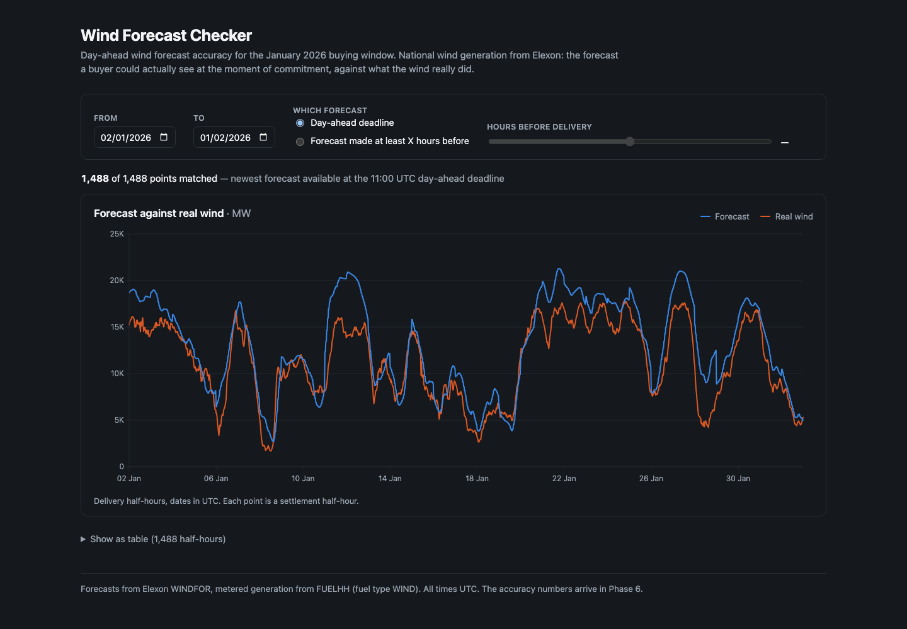
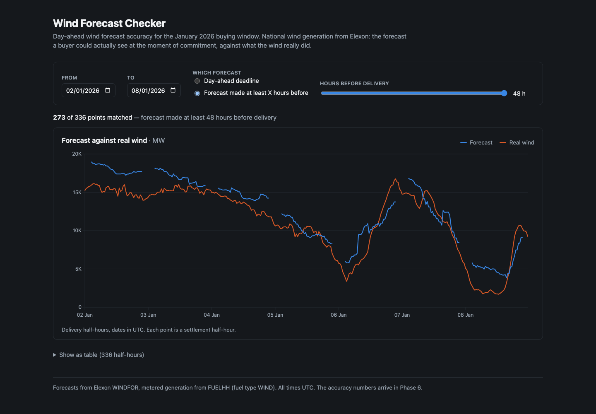
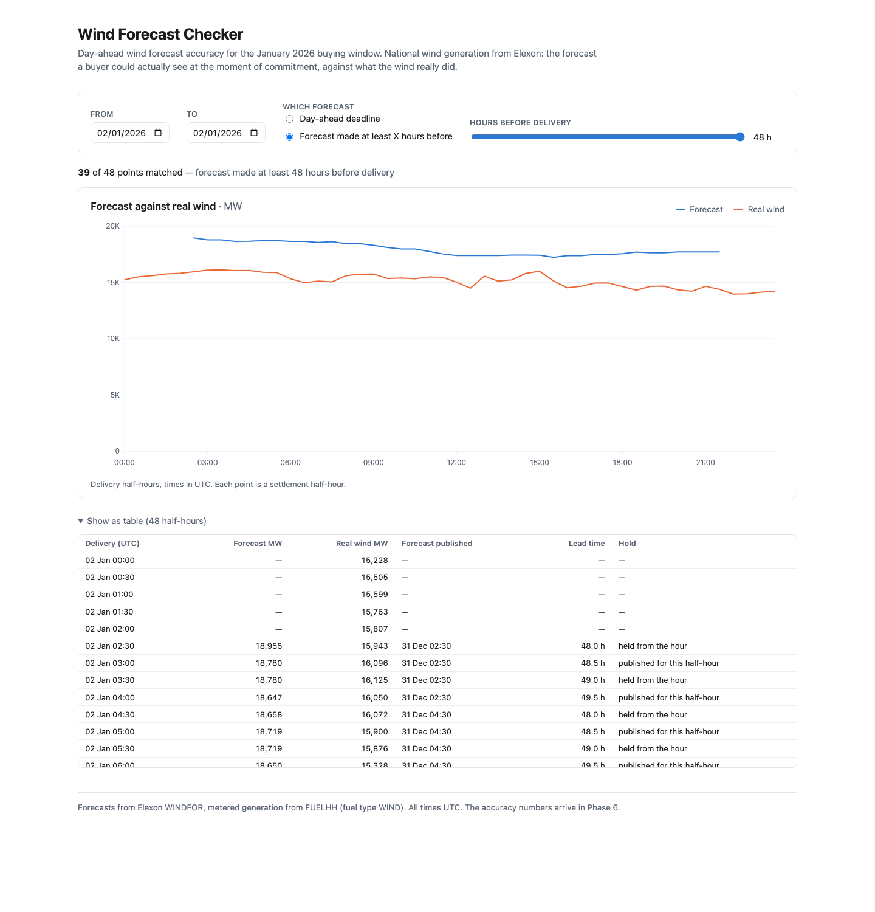
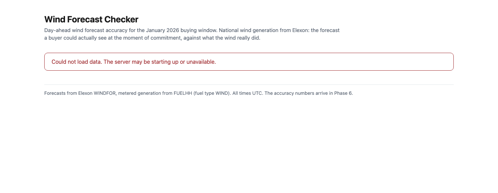
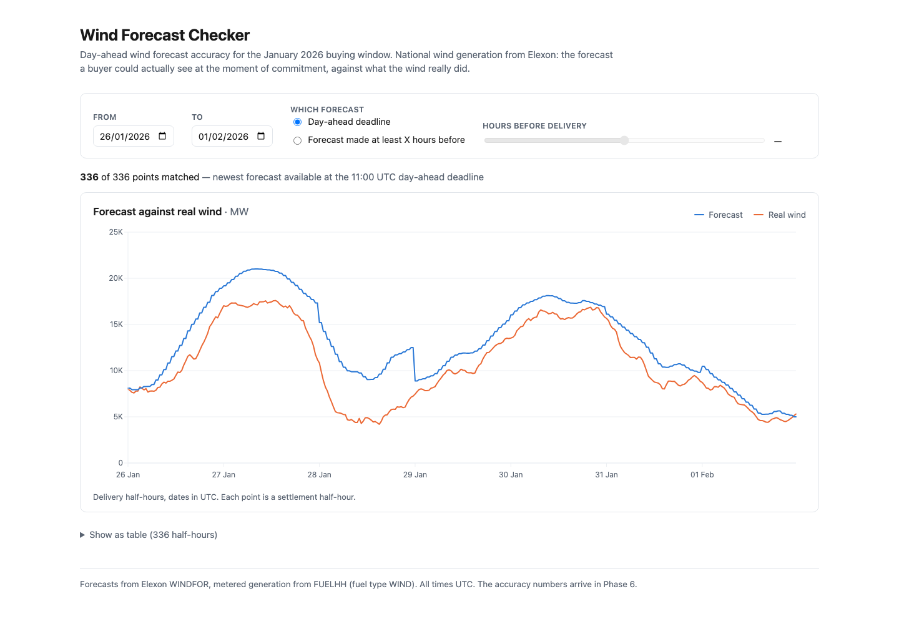

# Phase 5 — Screen 1, forecast vs real wind: evidence

Date: 2026-10-28. Branch: `build`.

The buyer's first question, answered: for any days in the delivery range, what the forecast said
before the buying deadline and what the wind actually did.

```bash
docker compose up --build
open 'http://localhost:5173/?mode=hours_ahead&hours=48'
```



## What was built

| File | Role |
|---|---|
| `components/Screen1.jsx` | fetches, owns control state, composes the rest |
| `components/Controls.jsx` | date range, mode switch, 0–48 slider — one row, above everything it scopes |
| `components/ForecastChart.jsx` | the Recharts composition and the hover readout |
| `components/SeriesTable.jsx` | the table twin |
| `lib/format.js` | UTC and megawatt formatters, in one place |
| `lib/seriesUrl.js` | control state ⇄ query string, and the `/api/series` URL |

No backend change. `/api/series` already returned everything this screen needs, which is what Phase 4
was for. `recharts` 3.10.1 added, exact-pinned to match the existing dependency style.

## Exit check

### 1. Moving the slider changes the forecast line; the real-wind line does not

Checked numerically rather than by eye, because "the orange line looks the same" is not evidence:

```
real wind identical across X=6/24/48 : True
forecast differs between X=6 and 48  : True
half-hours whose forecast changed    : 1488 of 1488
  X=6   matched  1488 of 1488
  X=24  matched  1488 of 1488
  X=48  matched  1209 of 1488
```

Every one of the 1,488 half-hours gets a different forecast at X=48 than at X=6, while the metered
generation is byte-identical across all three. That is the correct behaviour: the slider changes
*which forecast run you were allowed to see*, and it cannot change what the wind did.

### 2. A day with a known missing half-hour shows a visible gap

**This line cannot be satisfied as written, and the reason is worth recording.** It assumes Phase 1
found missing half-hours in the delivery range. It did not — `docs/notes/phase-1.md` records *missing
half-hours: 0*. The actuals are complete.

The gaps that genuinely exist come from the **forecast horizon running out**, measured across the
real data:

| Setting | Missing | Shape |
|---|---|---|
| `hours=44` | 31 | 31 isolated single half-hours |
| `hours=46` | 155 | 32 blocks, mostly 5 long |
| **`hours=48`** | **279** | **32 blocks of ~9** — a 4½-hour gap at the end of each delivery day |

So the check is met at `hours=48`, where the gap is unmissable:



The forecast line breaks at the end of each day while real wind continues — exactly what should
happen when no run published 48 hours early reached that far.

**Proved at the SVG level, not just visually.** A line that merely looks broken could be a rendering
artefact, so the rendered `path` was read back out of the DOM and its `M` (move-to) commands counted
— a continuous line has one, each break adds another:

```
hours_ahead X=48, 7 days
  forecast   path has 7 'M' commands  ->  6 breaks in the line
  real wind  path has 1 'M' command   ->  0 breaks

deadline mode, same 7 days
  forecast   path has 1 'M' command   ->  0 breaks
  real wind  path has 1 'M' command   ->  0 breaks
```

That is `connectNulls={false}` doing its job. Without it Recharts would draw straight through the
gap and invent a forecast the buyer never had (AGENTS.md rule 3).

### 3. The page cannot choose a date outside the range

The date inputs carry `min` and `max` from `/api/health`, so no date is typed into the page
(rule 2), and they are cross-constrained so "from" can never pass "to":

```
from-date  value=2026-01-02  min=2026-01-02  max=2026-01-08   (max = the current "to")
to-date    value=2026-01-08  min=2026-01-02  max=2026-02-01   (min = the current "from")

/api/health says: 2026-01-02 -> 2026-02-01
```

A hand-typed URL is clamped by the page before it is ever sent; the server is the backstop behind
that:

```
?start=2025-12-01                  400  {"error":"start must be between 2026-01-02 and 2026-02-01"}
?end=2026-03-01&start=2026-01-02   400  {"error":"end must be between 2026-01-02 and 2026-02-01"}
```

Worth being precise: because the page clamps, the 400 is genuinely hard to reach from the UI. It was
verified against the API directly rather than claimed from the screen.

### 4. Hover shows the publish time, and it is always before the cutoff

The hover gives all six things step 5 asks for — time, forecast, real wind, publish time, lead time,
and whether the value is held from the hour. The same six are in the table, which is how they are
shown here (a headless browser cannot hover):



The substantive claim is not "one tooltip looked right" but that **no displayed forecast was
published after its cutoff**, checked over every row in both modes:

```
deadline mode: 1488 rows carry a publish time
  published after the 11:00 cutoff    : 0
  published after the target time     : 0

hours_ahead X=48: 1209 rows carry a publish time
  published later than 48 h ahead     : 0
```

That is AGENTS.md rule 4 verified on what the screen actually displays, rather than inferred from the
unit tests.

The table also makes decision 0004 legible. Reading the rows for 2 Jan at X=48:

```
02 Jan 03:00   18,780 MW   published 31 Dec 02:30   48.5 h   published for this half-hour
02 Jan 03:30   18,780 MW   published 31 Dec 02:30   49.0 h   held from the hour
```

Same value, same source run, and the `:30` row says plainly that it is held. The hold is visible
rather than asserted.

## Design decisions worth knowing

**The two series colours were computed, not chosen.** They are categorical slots 1 and 2 of a
validated palette, run through a colour-vision validator in both modes:

```
light  CVD dE 24.7 (protan) · normal-vision dE 33.6 · all six checks pass
dark   CVD dE 26.8 (protan) · normal-vision dE 31.8 · all six checks pass
```

Both clear the ≥8 colour-vision target and ≥15 normal-vision floor with room to spare, so the chart
needs no dashing or texture as a backup channel. The dark values are stepped for a dark surface
rather than being the light ones brightened.

**One Y axis, anchored at zero.** Both series are megawatts. A second axis would let them be scaled
independently and make the gap between the lines meaningless — and that gap is the entire point of
this screen. Zero-anchoring matters for the same reason: a truncated baseline would exaggerate it.

**Straight segments, not a spline.** A smoothed curve bends between real observations and implies
values nobody published.

**The URL carries the state.** `?mode=hours_ahead&hours=48&start=…` round-trips, so a buyer can send
a colleague the exact view. It is also what made every state above screenshot-able.

**Two defects found and fixed while looking at the rendered page**, neither visible in code review:

- The y-axis auto-ticked to `5.5K / 11K / 16.5K`. Now anchored at zero and stepped in 5,000 MW.
- The `MW` axis label collided with the topmost tick. The unit moved into the heading.

And one real bug: the URL sync called `replaceState` with the query string alone, which **silently
dropped the fragment** — so a link to `#table` lost it on first render. Fixed by carrying the hash.

## Still honest about what is missing

Loading and failure states were moved out of `App.jsx` into `Screen1`, so Phase 3's guarantee now
runs through new code and was re-verified rather than assumed:



A refetch holds the previous chart at reduced opacity instead of flashing a skeleton, so dragging the
slider does not make the page jump.

## Verified in Docker

The frontend image bakes `node_modules` via `npm ci` with no volume mount, so a new dependency needs
a rebuild. Confirmed after `docker compose up --build`:

```
page:  http 200
proxy: {"applied":{"mode":"deadline", ...
recharts in the container: 3.10.1
```



That view is also the clearest picture of the problem the next phase quantifies: on 28 January the
forecast sat near 10 GW while the wind collapsed to about 5 GW.

Production build, which is what Vercel runs:

```
dist/assets/index-CDMutzNz.js   582.19 kB │ gzip: 173.65 kB
dist/assets/index-DHpsrHS4.css    4.98 kB │ gzip:  1.57 kB
```

Recharts is most of that 582 kB. It is one gzipped 174 kB download from a CDN, so it is acceptable,
but it is the obvious target if Phase 7 wants the page lighter.

Backend suite unchanged: **155 passed**.

## Scope held

No accuracy screen — no MAE, RMSE, bias or P90, no bias-corrected panel, no worst-days table, no
hours-ahead sweep chart. Those are Phase 6, which reuses these controls; that is why control state
sits one level above the chart and the controls own none of it.

Full responsive and phone layout stays Phase 7. The only layout change here is the page width, raised
from 48rem to 76rem, because 1,488 half-hourly points inside 768 px is a smear rather than a chart.

Not deployed. Phase 3 closed the deployment checks and `vercel --prod` is better spent once Screen 2
exists.

## Carried into Phase 6

- Lift `controls` from `Screen1` to `App` so both screens share one date range and mode. `Controls`
  is already presentational and needs no change.
- `/api/metrics` takes the identical query string — `seriesUrl.js` can grow a `metricsUrl` beside
  `seriesUrl` rather than rebuilding the mapping.
- Phase 6's "average miss vs hours-ahead" chart must sweep X by calling `/api/metrics` repeatedly.
  Phase 4 measured a 25-point sweep at 267 ms total, so this is affordable — but it must **not** be
  built by bucketing a deadline-mode series by lead time, which is confounded with hour of day at
  0.9993.
