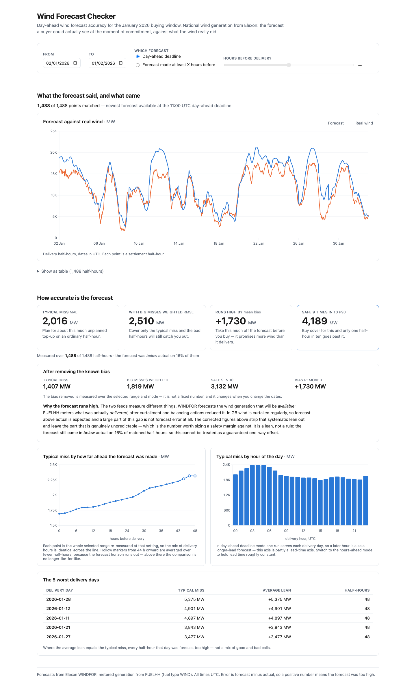
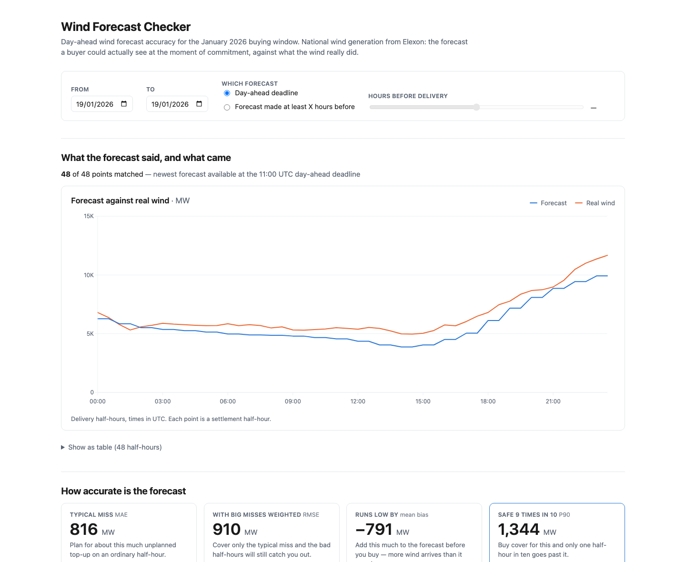
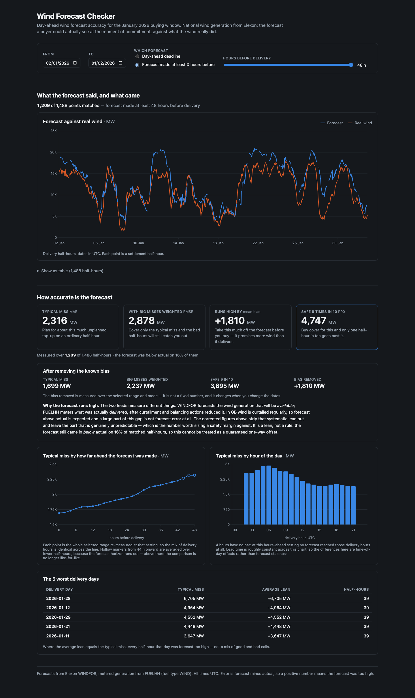

# Phase 6 — Screen 2, how accurate is the forecast: evidence

Date: 2026-10-28. Branch: `build`.

The buyer's second question, answered in plain numbers: how far the forecast usually misses, and
which way.

```bash
docker compose up --build
open 'http://localhost:5173/?mode=deadline&start=2026-01-02&end=2026-02-01'
```



## What was built

| File | Role |
|---|---|
| `components/Screen2.jsx` | fetches the metrics and runs the sweep, composes the section |
| `components/StatTiles.jsx` | the four numbers and the bias-corrected panel |
| `components/SweepChart.jsx` | typical miss by how far ahead, coverage marked |
| `components/HourOfDayChart.jsx` | typical miss by delivery hour |
| `components/WorstDaysTable.jsx` | the five worst delivery days |
| `lib/useFetch.js` | the fetch/cancel/debounce pattern, extracted so two screens share one copy |

`App.jsx` now owns the control state and `Screen1.jsx` takes it as a prop, so one filter row scopes
both screens. `Controls.jsx` needed **no change** — Phase 5 built it presentational for exactly this
move.

No backend change. Everything comes from `/api/metrics`, which Phase 4 already returned in full.

## The four numbers, phrased as procurement consequences

The plan requires each sentence to say *what the buyer does differently*, not what the statistic is
(`docs/product-plan.md:474-475`). As rendered:

| Tile | Figure | Sentence |
|---|---|---|
| Typical miss · MAE | 2,016 MW | Plan for about this much unplanned top-up on an ordinary half-hour. |
| With big misses weighted · RMSE | 2,510 MW | Cover only the typical miss and the bad half-hours will still catch you out. |
| Runs high by · mean bias | +1,730 MW | Take this much off the forecast before you buy — it promises more wind than it delivers. |
| Safe 9 times in 10 · P90 | 4,189 MW | Buy cover for this and only one half-hour in ten goes past it. |

Each tile also carries the measure's real name, so a reviewer can map it to decision 0005 while a
buyer reads the sentence. P90 is the one a buyer actually sizes cover against, so it carries the
accent border.

### The bias tile follows the sign

"Runs high by" is only true while the bias is positive. On 19 January the forecast ran **low**, and
the tile says so on its own — title, sign and sentence all flip:

```
Runs low by  mean bias
−791 MW
Add this much to the forecast before you buy — more wind arrives than it promises.
```



The Screen 1 chart above it agrees: the forecast line sits below real wind for most of that day. A
hardcoded "Runs high by" would have told a buyer to trim a forecast that was already too low.

## Exit check

### 1. A newcomer can explain each big number from its sentence alone

The four sentences above carry no statistical vocabulary in the explanation — the measure name sits
beside the title for the reviewer, and the sentence stands on its own for everyone else.

### 2. Every number on screen matches `/api/metrics`

Not eyeballed. The rendered DOM was scraped and each figure compared against a direct API call for
the same settings:

```
rendered tile                                     value      /api/metrics   match
  Typical miss MAE                               2,016 MW      2,016        YES
  With big misses weighted RMSE                  2,510 MW      2,510        YES
  Runs high by mean bias                        +1,730 MW      1,730        YES
  Safe 9 times in 10 P90                         4,189 MW      4,189        YES

bias-corrected panel   1,407 / 1,819 / 3,132 / +1,730   all present
worst days             2026-01-28 5,375 · 01-12 4,901 · 01-11 4,897
                       01-21 3,843 · 01-27 3,477        all present
coverage readout       1,488 of 1,488                   present
```

### 3. No number is typed into the page

`AGENTS.md` rule 2, checked by grep rather than asserted:

```bash
grep -rnE '\b(2016|2510|1730|4189|1407|1819|3132|5375|4901|4897|3843|3477|1488|1691|2226|2316)\b' frontend/src
#   no measured figure appears anywhere in frontend/src
```

### 4. Changing the date range changes all four numbers

```
           whole   last week   changed
mae         2016        2379     YES
rmse        2510        2870     YES
bias        1730        2376     YES
p90         4189        5174     YES
```

### 5. The hours-ahead chart shows bigger misses for forecasts made earlier — when swept

Built by **sweeping X** across whole series: 25 calls to `/api/metrics?mode=hours_ahead&hours=X`,
run in parallel. Strictly rising at every step across the complete-coverage region:

```
X=0  MAE 1691  ->  X=42  MAE 2226   (1,488 of 1,488 half-hours throughout)
strictly rising across every complete-coverage step: True
```

It is **not** built by bucketing a deadline-mode series by lead time. Phase 2 showed why, and it was
confirmed again here: in deadline mode one run serves each delivery day, so mean lead time runs
monotonically from 14.8 h at delivery hour 00 to 37.8 h at hour 23, correlating with hour of day at
0.9993. A lead-time-bucketed chart therefore relabels overnight wind behaviour as forecast
staleness, and it slopes the wrong way. `by_lead_time` is returned by the API and deliberately left
unplotted.

### 6. Above ~42 hours the comparison is no longer like-for-like, and it is visible

The horizon runs out, so the tail is averaged over fewer half-hours:

```
X=44  MAE 2266   1457 of 1488 (98%)
X=46  MAE 2316   1333 of 1488 (90%)
X=48  MAE 2316   1209 of 1488 (81%)
```

Those points render as **hollow markers**, the count travels in the tooltip, and the caption says
"Hollow markers from 44 h onward are averaged over fewer half-hours… the comparison is no longer
like-for-like."



## A documentation error, not reproduced

Exit-check line 491 says MAE goes *"from 1,691 MW at 0 h to 2,320 MW at 46 h."* The recorded sweep
says **2,316 MW at X=46**; 2,320 is the value at **X=47** (`docs/notes/phase-0.md:112-122`). The
same mislabel sits at `docs/notes/phase-0.md:27`. The claim itself — error rises with lead time —
holds through X=47 and then dips slightly at 48. This phase quotes the measured values rather than
propagating the wrong label, and the plan line should be corrected when something else touches it.

## Two defects found by looking at the rendered page

**The sweep chart's y-axis was anchored at zero**, which left the whole line in the top quarter and
made a 37% rise read as flat. Columns must grow from zero or their lengths stop meaning anything,
but nothing on a trend line is a length measured from the origin. The axis now fits the data and
starts on a round number, and the hour-of-day columns keep their zero baseline. They sit side by
side, so the difference is deliberate and visible.

**The hour-of-day axis silently shifted.** At 48 hours ahead, delivery hours 00 and 01 have no
matched half-hours at all, the API correctly omits them, and the chart started its axis at 02 — so
an hour with no data looked like an hour that did not exist. The chart now always renders all 24
slots, filling absent hours with `null` (never `0`, which would claim a perfect forecast), and says
so:

```
hour-of-day axis ticks: ['00','03','06','09','12','15','18','21']
bars rendered         : 20
caption               : "4 hours have no bar: at this hours-ahead setting no
                         forecast reached those delivery hours at all."
```

## An honesty label on the hour-of-day chart

In **deadline** mode the chart reads: *"one run serves each delivery day, so a later hour is also a
longer-lead forecast — this axis is partly a lead-time axis."* In **hours-ahead** mode lead time is
roughly constant, so it reads: *"the differences here are time-of-day effects rather than forecast
staleness."*

The caveat is qualitative on screen because a number there would need its own script (rule 2). The
measurement behind it, run while planning: the hourly profile is worst at 05:00 and best at 15:00 in
**both** modes, and the two profiles correlate at **0.942**. So the diurnal pattern is real and
survives holding lead time constant — but the deadline-mode chart alone cannot demonstrate that,
which is why it does not claim it.

## Verified in Docker

```
served from Docker:
   Typical miss MAE = 2,016 MW
   With big misses weighted RMSE = 2,510 MW
   Runs high by mean bias = +1,730 MW
   Safe 9 times in 10 P90 = 4,189 MW
  charts rendered: 3
```

Production build: `617 kB JS (181 kB gzipped)`, up from 582 kB — Screen 2 adds about 35 kB for the
bar chart and the new components. Backend suite unchanged: **155 passed**.

## Scope held

No phone or responsive layout work, no loading/error-state polish, no `backend/scripts/findings.py`
and no `docs/findings.md` — all four are Phase 7. No measures beyond decision 0005; MAPE was
considered and rejected there because wind approaches zero and percentage error explodes.

Not deployed. `vercel --prod` is worth spending once Phase 7's polish lands.

## Carried into Phase 7

- **The page is long and desktop-shaped.** The two-chart row uses `minmax(26rem, 1fr)`, the tiles
  `minmax(14rem, 1fr)`; both collapse to one column on a narrow screen, but this has not been looked
  at near 380 px, which is Phase 7's exit check.
- **The bundle is 617 kB** (181 kB gzipped) and Recharts is most of it — the obvious target if the
  page needs to be lighter.
- `findings.py` has three findings waiting, all measured here: the systematic high bias and its
  curtailment explanation; the rise from 1,691 MW to 2,226 MW as commitment moves earlier; and the
  worst-day signature where mean bias equals MAE, meaning every half-hour that day was forecast too
  high.
