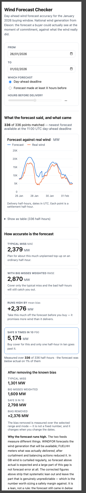
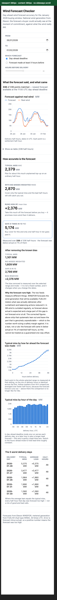
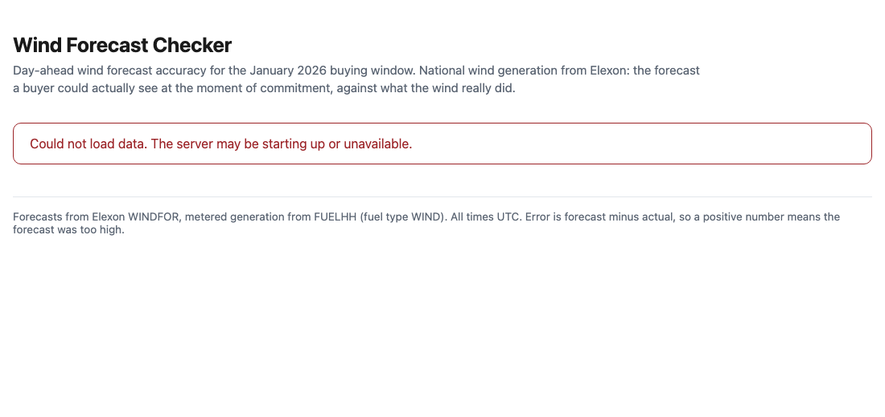

# Phase 7 — Polish and write the findings: evidence

Date: 2026-10-28. Branch: `build`.

Two jobs, neither a feature: make the layout behave at phone width, and produce
`docs/findings.md` from a script so the video has numbers nobody typed.

## The phone problems, listed before coding

The build prompt asks for this list first. Predicted by auditing the CSS and chart props
against a 380 px viewport, which leaves ~348 px of content after `main`'s padding:

| # | Predicted problem | Verdict after measuring |
|---|---|---|
| 1 | `.chart-pair` forces sideways scroll — `minmax(26rem, 1fr)` is a 416 px floor | **Confirmed.** Worth 48 px of the 52 px overflow |
| 2 | X-axis labels collide on all three charts | **Confirmed** — `minTickGap={0}`, 9 fixed ticks, `interval={2}` |
| 3 | Charts too tall (26rem / 17rem) | Confirmed |
| 4 | Tile type desktop-scaled | Confirmed |
| 5 | Worst-days table has no scroll container | **Confirmed.** The remaining ~4 px |
| 6 | Two identical error boxes when the API dies after health succeeds | Confirmed |
| 7 | *(not predicted)* dead space under the slider | **Found while looking.** `.slider-group` has `flex: 1 1 15rem`; once the controls became a column that width basis turned into a 15rem **height** |

## Measuring 380 px honestly — the first attempt was wrong

The obvious check, `--window-size=380`, **does not work**: macOS Chrome clamps its window to
about 500 px, so the page lays out at 500 px and the screenshot is simply cropped to 380. That
looks exactly like horizontal overflow and is not.

Proof it was clamping rather than the page misbehaving — the chart measured the same width at two
different viewport widths, and hiding every section in turn changed nothing:

```
viewport  320px -> chart svg width 447      hide .controls      -> 447
viewport  380px -> chart svg width 447      hide .tiles         -> 447
viewport  560px -> chart svg width 507      hide .panel         -> 447
viewport  900px -> chart svg width 826      hide .table-scroll  -> 447
                                            hide .chart-head    -> 447
```

447 px is exactly 500 − 24 (page padding) − 27 (card padding) − 2 (border). `--headless=new`
clamps identically.

So the app was rendered in a **380 px iframe** instead, which gives it a genuine 380 px viewport.
Served same-origin, the harness can read the frame's own layout, so "does it scroll sideways"
becomes a measurement rather than an opinion:

```js
var el = document.getElementById('app').contentDocument.documentElement
el.scrollWidth > el.clientWidth   // this is what "scrolls sideways" means
```

### The exit-check result

```
BEFORE: viewport 380px · content 432px · SCROLLS SIDEWAYS by 52px
AFTER:  viewport 380px · content 380px · no sideways scroll
```

And isolating the cause, by reverting one fix at a time:

```
both fixes:      viewport 380px · content 380px · no sideways scroll
table fix only:  viewport 380px · content 428px · SCROLLS SIDEWAYS by 48px
```

So the grid track was the dominant cause and the table the remainder. One caveat on the
diagnostic: it also reports the widest element, which names a `<table>` in both runs — tables
inside an `overflow: auto` container legitimately extend past the viewport without causing
document overflow, so that readout points at a symptom, not the cause.





## What changed

**`min()` is the fix that matters.** A bare `minmax(26rem, 1fr)` sets a 416 px floor on the
track, and a grid cannot shrink below its own track — so the row pushed the *whole page* wider
than the viewport and every section then rendered clipped, not just that one:

```css
grid-template-columns: repeat(auto-fit, minmax(min(26rem, 100%), 1fr));
```

**Tick density is a prop, not a style**, so no media query can reach it. Each chart now lets
Recharts thin crowded labels: `minTickGap` 28 / 24 / 16, and the hour chart's `interval={2}`
became `preserveStartEnd`. At 380 px the Screen 1 axis shows four dates; at 1440 px the hour
chart shows all 24 — the same props, adapting.

**One media query**, the first width breakpoint in the project, holds every phone adjustment:
charts 26rem → 15rem and 17rem → 13rem, controls stacked one per line, tile values 2.1rem →
1.7rem, page padding tightened.

**One error message, not two.** Both screens now report failures upward instead of rendering
their own box; `App` shows it once. Structurally guaranteed rather than asserted:

```
$ grep -rn 'status error' frontend/src
frontend/src/App.jsx:76:  <p className="status error">{failure || screenFailure}</p>
```

Phase 3's guarantee re-verified, because this phase moved the code that implements it:



## `docs/findings.md`

Generated, never edited:

```bash
uv run python backend/scripts/findings.py > docs/findings.md
```

The exit check is that every number in the file came from the script. That is checkable rather
than inspectable:

```
$ diff <(.venv/bin/python backend/scripts/findings.py) docs/findings.md
  diff is EMPTY — every number in the file came from the script
```

The script recomputes nothing: it calls the same `build_series` / `summarise` pair the API
serves, so the findings and the screens cannot disagree. It reads the committed CSVs, so it needs
no server and no network. One thing no other script in `backend/scripts/` does is import from
`app.*`; run as a script, `sys.path` gets `backend/scripts/`, not `backend/`, so it inserts
`backend/` on the path with a comment saying why.

Phase 10 is told to use **only** numbers from this file, so it ends with a summary table of the
raw and corrected measure sets and the five worst days — otherwise the video script would be
blocked on a figure that lives only on screen.

### The script's output, in full

```text
# Findings

Three things the January 2026 data says about the day-ahead wind forecast, for a team buying power one day before delivery.

Delivery days 2026-01-02 to 2026-02-01: 1,488 half-hours, of which 1,488 had a forecast the buyer could have seen at the 11:00 UTC deadline.

Generated by `backend/scripts/findings.py`. Every number here is that script's output; none was typed by hand.

## 1. The forecast leans high, and most of that lean is not forecast error

Across January the forecast ran **+1,730 MW above** what the wind actually delivered, on average. That lean is 86% of the 2,016 MW typical miss, and the forecast came in high on **84%** of matched half-hours.

The reason matters more than the number. The two feeds measure different things: the forecast describes the wind generation that will be *available*, while the metered figure is what was actually *delivered*, after curtailment and balancing actions reduced it. In GB wind is curtailed regularly, so a forecast above actual is expected, and a large part of this gap was never a forecasting failure.

Remove that known lean and the typical miss falls from 2,016 MW to **1,407 MW**, a reduction of 30%. That smaller number is the part that is genuinely unpredictable.

**What a buyer does differently:** subtract roughly 1,730 MW from the headline forecast before deciding how much to buy, and size the safety margin against the corrected error rather than the raw one. It is a lean, not a rule - the forecast still fell below actual on 16% of half-hours - so it cannot be treated as a guaranteed one-way offset.

## 2. The earlier you must commit, the worse the forecast gets

Measured by re-running the whole month at each setting, so the mix of delivery hours is identical every time:

| Forecast made at least | Typical miss | Half-hours compared |
|---|---|---|
| 0 hours before delivery | 1,691 MW | 1,488 |
| 24 hours before delivery | 1,945 MW | 1,488 |
| 42 hours before delivery | 2,226 MW | 1,488 |

Committing 42 hours ahead instead of at delivery time costs **535 MW** of accuracy, a 32% increase in the typical miss.

**What a buyer does differently:** treat the day-ahead deadline as a cost, not just a constraint. Any flexibility that moves a decision later is worth up to 535 MW of error per half-hour, which is the figure to weigh against whatever that flexibility costs to buy.

## 3. Size cover on the bad half-hours, not the average one

The typical miss is 2,016 MW, but nine times out of ten the miss was under **4,189 MW** - 2.1 times the average. Cover built to the average is short in one half-hour out of every ten.

Whole days behave this way too. The worst delivery day, **2026-01-28**, missed by 5,375 MW on average across its 48 half-hours - and its mean bias was +5,375 MW, identical to the miss. Every single half-hour that day was forecast too high. A bad day is not a mix of good and bad calls; it is one wrong call repeated 48 times.

**What a buyer does differently:** hold cover against the 4,189 MW figure rather than the 2,016 MW one, and expect the shortfall to arrive as whole bad days rather than scattered bad half-hours - which is a position to plan overnight, not something to fix half-hour by half-hour.

## The numbers behind these findings

Day-ahead deadline mode, whole delivery range.

| Measure | Raw | After removing the lean |
|---|---|---|
| Typical miss (MAE) | 2,016 MW | 1,407 MW |
| With big misses weighted (RMSE) | 2,510 MW | 1,819 MW |
| Average lean (mean bias) | +1,730 MW | 0 MW |
| Miss beaten 9 times in 10 (P90) | 4,189 MW | 3,132 MW |
| Half-hours measured | 1,488 | 1,488 |

Lean removed: +1,730 MW, measured over this same range.

Worst five delivery days, by typical miss:

| Day | Typical miss | Average lean | Half-hours |
|---|---|---|---|
| 2026-01-28 | 5,375 MW | +5,375 MW | 48 |
| 2026-01-12 | 4,901 MW | +4,901 MW | 48 |
| 2026-01-11 | 4,897 MW | +4,897 MW | 48 |
| 2026-01-21 | 3,843 MW | +3,843 MW | 48 |
| 2026-01-27 | 3,477 MW | +3,477 MW | 48 |
```

## Verification

```
155 passed                                     (backend untouched)
dist/assets/index-DjpUYyCs.js   618.20 kB │ gzip: 181.76 kB
dist/assets/index-BwXMg_jO.css    8.12 kB │ gzip:   2.21 kB
```

The bundle grew 1 kB; the CSS grew 0.7 kB for the breakpoint. Desktop was re-checked and is
unchanged apart from the hour chart now labelling more hours where there is room for them.

## Scope held

Phase 8 untouched: no CORS, no safety headers, no non-root Docker users, no `gitleaks` /
`pip-audit` / `npm audit`, no dependency bumps. The README stays the Phase 9 placeholder it
already is. The only behavioural change is one error message instead of two.

The 380 px harness was deliberately **not** committed — it is five lines of throwaway HTML, and
the measurement it performs is reproduced above so anyone can rerun it.

## Carried into Phase 8

- Dependencies are pinned exactly (`recharts` 3.10.1, `fastapi` 0.162.0, `pandas` 3.1.0), so
  `npm audit` / `pip-audit` findings will need deliberate bumps rather than range resolution.
- `.env.example` and `.gitignore` were written in Phase 0a and have not been revisited; Phase 8
  verifies rather than recreates them.
- The git history was rewritten in Phase 3 to correct an author email. `gitleaks` scans history,
  so it will walk the rewritten commits — the pre-rewrite objects are unreferenced locally but
  may still exist until git garbage-collects them.
