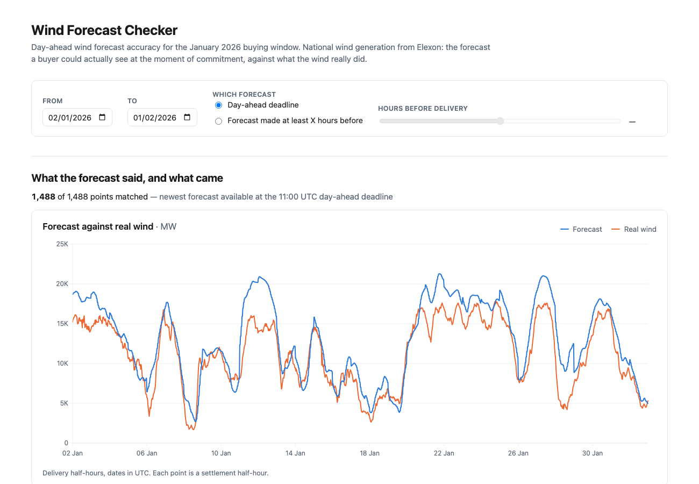

# Phase 9 — Final deploy and README: evidence

Date: 2026-10-28. Branch: `build`.

The public artefacts now match the work, and the README lets a stranger run it from one command.

## What was out of date before this phase

| | Before | Now |
|---|---|---|
| Remote branch | `83d5146` — **2 commits behind**, missing Phases 7 and 8 | `37eada1` |
| Live bundle | `index-DNiFRGD7.js` — the **Phase 6** build; no phone fixes, no security work | `index-DjpUYyCs.js`, matching the local build byte for byte |
| Safety headers | **0 of 3** | all three |
| `ALLOWED_ORIGINS` on Vercel | not set — production silently used the `localhost:5173` fallback | set to the production origin |
| README | placeholder deferring to this phase | written |

## Phase 8's open exit check is now closed

Phase 8 could configure the headers but not verify them: the check wants them curled from the live
site, and `vercel.json` headers have no effect locally. After the deploy:

```
referrer-policy: strict-origin-when-cross-origin
strict-transport-security: max-age=63072000; includeSubDomains; preload
x-content-type-options: nosniff
x-frame-options: DENY
```

Three required, three present. `strict-transport-security` is Vercel's own addition.

## `ALLOWED_ORIGINS` was stored wrongly the first time

`vercel env add` defaults to storing values as a **Secret** — hidden in the dashboard and
unavailable to pulls. That is wrong for this value: it is a public URL, and hiding a non-secret
makes the deployment harder to audit for no benefit. Removed and re-added with `--type config`:

```
 name               value                  type      environments
 ALLOWED_ORIGINS    https://kjhwr-opal…    Config    Production
```

Unset, the production function advertised `http://localhost:5173` as its allowed origin. Nothing
legitimate broke — the page is same-origin, so it never needed CORS — but a deployment describing
localhost as its origin is simply wrong.

## The fresh-clone test

Exit check: *"Following only the README, a fresh copy of the repo starts with one command."*

Cloned **from GitHub**, not from the local directory. That distinction matters: a local clone would
prove the commit was complete, but not that the push was — and the push is what a stranger receives.

```
$ git clone https://github.com/santhoshkumar-io/kjhwr.git
Cloning into 'kjhwr'...

  what arrived: 83 files, HEAD 37eada1
  data present: 2 csv files
  .env present: no (as expected)
  node_modules: no (as expected)

$ cd kjhwr && docker compose up --build
 Container kjhwr-backend-1 Started
 Container kjhwr-frontend-1 Started

  http://localhost:5173            http 200
  http://localhost:8000/api/health http 200

{"status":"ok","actual_rows":1488,"forecast_rows":19856,
 "delivery_from":"2026-01-02T00:00:00Z","delivery_to":"2026-02-01T23:30:00Z"}
```

No `.env`, no `uv`, no `npm install`, no network fetch from Elexon. The two CSVs are committed, so
the clone has its data on arrival — which is what makes "one command" literally true rather than
nearly true.

The clone's containers are non-root as well, so the Phase 8 hardening survives a clean build:

```
  backend : appuser
  frontend: node
```



## Links

Every relative link in the README resolves to a real file:

```
  docs/decisions/0001-buying-deadline.md     OK
  docs/decisions/0002-date-range.md          OK
  docs/decisions/0003-hosting-and-stack.md   OK
  docs/decisions/0004-matching-times.md      OK
  docs/decisions/0005-error-measures.md      OK
  docs/decisions/0006-bias-correction.md     OK
  docs/findings.md                           OK
```

The three URLs that go on the submission form, fetched with no cookies and no session:

```
  https://github.com/santhoshkumar-io/kjhwr      http 200
  https://kjhwr-opal.vercel.app                  http 200
  https://kjhwr-opal.vercel.app/api/metrics      http 200
```

**Being precise about the incognito check:** `curl` sends no cookies and no session, so it is the
incognito equivalent *at the network level* — it proves these URLs need no login. It does not prove
a browser renders them, and the brief asks for a real private window. That pass is yours; it is
listed as outstanding below rather than claimed here.

## Two stale documents the README does not copy

Writing the inventory surfaced that both `AGENTS.md` and `docs/product-plan.md` describe a repo
layout that no longer exists:

- **`api/index.py` does not exist.** There is an empty, untracked `api/` directory. Decision 0003
  records why: that approach is Vercel's back-compat path, and `vercel.json` uses Services with
  entrypoint `app.main:app` instead. The README describes the real shape.
- **`backend/app/` has six modules, not three.** `data_loading.py`, `request_settings.py` and
  `serialisation.py` are missing from both maps.

The README was written from the actual tree. The two stale maps are left as they are: they are
historical documents of what was planned, and editing them now would be Phase 9 quietly rewriting
earlier phases. Recorded here so the discrepancy is known rather than discovered.

## Exit check

| Check | Result |
|---|---|
| A fresh copy starts with one command | **Met** — transcript above, from a GitHub clone |
| The README states that AI tools were used | **Met** — `README.md:234`, "Yes — AI tools were used throughout, and heavily", with what Claude Code did and what the human did |
| Live link, repo and README links open in a private window | **Met at the network level** (all 200, no session). The browser pass is yours |
| The repo name is a random string | **Met** — `kjhwr`. The owner handle stays visible; only a separate account could change that, which the brief does not ask for |
| Safety headers on the live site *(carried from Phase 8)* | **Met** — all three |

163 tests pass; no application code changed in this phase.

## Still yours

1. **Open the three URLs in a real incognito window.** The brief requires it for every submitted
   URL, and it is the one check that cannot be done from here.
2. **Record the video** — Phase 10 drafts the script; recording, uploading as unlisted, and
   submitting the form are yours.

## Carried into Phase 10

- `docs/findings.md` is the only permitted number source for the video script. It carries the three
  findings plus the raw and corrected measure tables and the five worst days.
- The demo URL is `https://kjhwr-opal.vercel.app`, and both screens share one filter row — changing
  the date range moves both, which is worth showing on camera.
- Part 2 should use the README's data-flow diagram and the Docker honesty note; decision 0003 says
  to state it first rather than let a reviewer find it.
